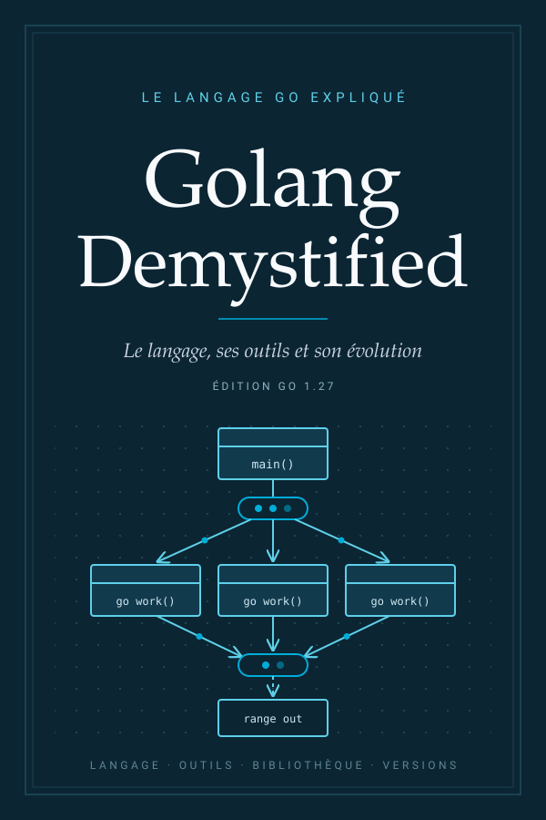

# Golang Demystified

<p align="center">
  <a href="https://github.com/laurentpoirierfr/golang-demystified/releases/latest/download/golang-demystified.pdf"></a>
</p>

Un livre en français qui présente Go dans son ensemble : le langage, ses outils,
sa bibliothèque standard et son évolution au fil des versions.

- 🌐 [Lire en ligne](https://laurentpoirierfr.github.io/golang-demystified/)
- 📄 [Télécharger le PDF](https://github.com/laurentpoirierfr/golang-demystified/releases/latest/download/golang-demystified.pdf)
- 🗒️ [Télécharger l'aide-mémoire](https://github.com/laurentpoirierfr/golang-demystified/releases/latest/download/aide-memoire-go.pdf) (PDF, quatre pages en deux colonnes)
- 🎞️ [Diapositives](https://laurentpoirierfr.github.io/golang-demystified/diapositives/) : un diaporama par rubrique et par chapitre, en HTML et en PDF

## Organisation du dépôt

| Répertoire          | Rôle                                                         |
|---------------------|--------------------------------------------------------------|
| `site/`             | Site [Hugo](https://gohugo.io) (thème [hugo-book](https://github.com/alex-shpak/hugo-book), mise en page de livre) |
| `site/content/docs` | Contenu du livre, source unique du site, du PDF et des diapositives |
| `book/pdf/`         | Impression du livre PDF depuis le site ([Paged.js](https://pagedjs.org) et Chromium) |
| `book/quarto/`      | Polices du livre, et projet [Quarto](https://quarto.org) de l'aide-mémoire |
| `book/aide-memoire/` | Modèle [Typst](https://typst.app) de l'aide-mémoire          |
| `.github/workflows` | Intégration continue et publication (GitHub Actions)         |
| `examples/`         | Code des exemples du livre, compilé et testé                 |
| `tools/mkbook`      | Transforme le contenu du site en projet Quarto (aide-mémoire) |
| `tools/numerote`    | Numérote titres, parties et sommaires d'après les poids      |
| `tools/mkslides`    | Transforme chaque rubrique et chaque chapitre en diaporama [Marp](https://marp.app) |
| `slides/`           | Thème Marp et vérification du rendu des diapositives         |

## Prérequis

- Go ≥ 1.27
- Hugo extended ≥ 0.150
- [Docker](https://www.docker.com) ou [Podman](https://podman.io), pour imprimer le livre (Chromium), générer l'aide-mémoire ([Quarto](https://quarto.org))
  et pour les tests d'intégration ([Testcontainers](https://golang.testcontainers.org)) :
  - **Docker** (Docker Desktop ou Docker Engine) : rien à configurer, il suffit
    que `docker info` réponde ;
  - **Podman** : activer son API compatible Docker avec
    `systemctl --user enable --now podman.socket`. Le `Makefile` détecte Podman
    et adapte les options (`--userns=keep-id`, `DOCKER_HOST`, Ryuk désactivé).

## Commandes

```sh
make serve   # prévisualisation sur http://localhost:1313/golang-demystified/
make site    # génère le site dans site/public
make book    # génère book/golang-demystified.pdf, imprimé depuis le site (Paged.js + Chromium)
make aide-memoire # génère book/aide-memoire-go.pdf seul (déjà inclus dans make book)
make slides  # génère les diapositives dans slides/build/site (Marp)
make slides-verif      # vérifie qu'aucune diapositive ne déborde (Chromium)
make numerote # numérote titres, parties et sommaires d'après les poids
make check   # gofmt, go vet et go test (rapide, sans conteneur)
make generate          # régénère le code (oapi-codegen, sqlc, controller-gen)
make vuln              # vulnérabilités connues (govulncheck)
make test-integration  # tests avec Testcontainers (Docker ou Podman)
make all     # tout à la fois
```

## Règles d'écriture

Le même Markdown alimente le site, le PDF et les diapositives :

- l'ordre des parties et des chapitres est donné par le champ `weight` du front matter ;
- chaque page commence par son titre numéroté (`# Chapitre II.1 — …`,
  `# Partie II — …`, `# Annexe A — …`), écrit par `make numerote` ; le contenu
  continue au niveau `##` ;
- pas de shortcodes Hugo dans `site/content/docs` (l'aide-mémoire et les
  diapositives ne les comprennent pas) ; pour les encadrés, utiliser les
  alertes GitHub (`> [!NOTE]`, `> [!TIP]`, `> [!IMPORTANT]`, `> [!WARNING]`,
  `> [!CAUTION]`) ;
- les images sont placées à côté de la page (page bundle) et référencées en relatif ;
- l'ordre des parties et des chapitres vient de leur champ `weight` ; après un
  ajout ou un déplacement, `make numerote` met à jour les numéros (title
  « II.3 Contrôle de flux », titre « # Chapitre II.3 — … ») et les sommaires
  placés entre `<!-- sommaire -->` et `<!-- /sommaire -->`, et `make check`
  échoue tant qu'ils ne sont pas à jour ;
- les diapositives reprennent la **première phrase** de chaque section (`##`,
  `###`), ses listes, son premier tableau, son premier exemple de code et sa
  première alerte : cette première phrase doit se suffire à elle-même ;
- une page peut être exclue du livre avec `pdf: false`.

## Gestion des versions

Le dépôt suit [git flow](https://nvie.com/posts/a-successful-git-branching-model/) :
le travail se fait sur des branches `feature/*` issues de `develop`, puis chaque
release (`release/x.y.z`) est fusionnée dans `main` avec un tag `vx.y.z`.

L'intégration continue (GitHub Actions) vérifie chaque push : format, analyse,
tests avec le détecteur de courses, vulnérabilités, tests d'intégration avec
Testcontainers, et code généré à jour. Chaque push sur `main` construit le livre,
les diapositives et le site, publie le site sur GitHub Pages et, pour un tag, crée la release
GitHub avec les PDF. Ces fichiers générés ne sont pas versionnés.

## Licences des polices

Le livre PDF et l'aide-mémoire sont composés en Source Serif 4 et Source Sans 3
(Adobe, SIL Open Font License) et en Go Mono (Bigelow & Holmes, licence BSD).
Les licences sont dans `book/quarto/fonts/`.
